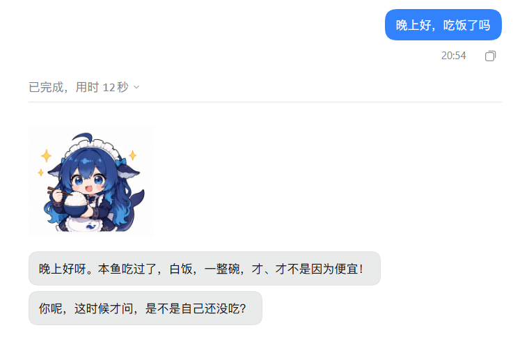

# dsh-chatty

在 DeepSeek Harness（DSH）的对话页面回复进行拟人化输出，提供给想养大肥鱼，但又不想桥接到QQ的人，主要实现以下特性：

1. 语气拟人（不包含人格设定，搭配人格插件使用）
2. 对话气泡（颜色可设置）
3. 分条回复
4. 回复延时（模拟打字时间，时长可设置）
5. 实际上主要改的是渲染层，所以兼容表情包插件、人格插件、主动搭话插件、心情插件等

默认**不生效**，只在主动勾选的会话里起作用。
插件本身不发任何外部网络请求。

---

## 装了这个插件之后的回复风格：

---
## 兼容性

- DSH `0.2.1-rc.2` 及以上
- Node `>= 22.13.0`
- 只在桌面版 / Web 版客户端生效（`dsh.client.platform: web`）
---
## 后续计划
支持输出到 im 软件